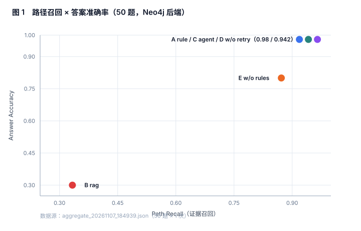
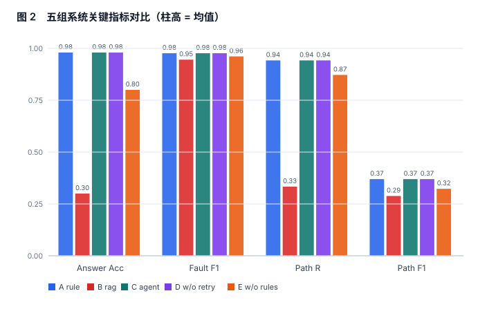

# 智维 Copilot：面向扫地机售后的知识图谱推理助手（RefKG-lite）

**场景 C：企业知识管理 KG-Agent** ｜ 机型：科沃斯 DEEBOT T20 PRO ｜ 日期：2026-10-29

---

## 1. 问题背景与目标

扫地机售后排查的知识是碎片化的：**用户手册**按工程视角组织（故障 → 原因 → 方法），
**官网 FAQ** 按用户视角组织（一句话现象 → 一串步骤），**历史工单**记录的是真实发生过的组合。
三类材料各有各的切法，客服人员实际处理的却是一句口语化描述：「拖完地总有一股臭味」「基站下面老是有水」。

把这句话答准，需要同时完成四件事：认出用户说的是哪个症状、把症状映射到可能故障、
在多个候选里排出先后、把结论落回可核查的原文。纯 LLM 方案在第 2 步和第 4 步最容易出问题——
它会编出一个手册里不存在的故障名，或者给出一条听起来合理却与机型不符的处置。

本项目要验证的是：**把知识约束在图谱里、把推理约束在声明式规则里，能否让系统在可追溯的前提下
把排查做对，并且能明确地拒绝答不了的问题。**

具体目标与验收口径：

| 目标 | 验收方式 | 结果 |
| --- | --- | --- |
| 知识可追溯 | 每条边强制 `evidence` + `sourceId`，覆盖率 100% | 432 实体 / 1028 关系的证据覆盖率 100%，悬空边 0、孤立点 0 |
| 推理可审计 | 结论必须带证明树（原子 → 规则 → 结论） | 24 条规则，每次诊断输出 firedRules 与证明子图 |
| 能拒绝 | 超范围、跨型号串码、证据不足要明确降级 | 7 道无解题全部给出降级说明而非编造 |
| 效果可量化 | 50 题、5 组系统、3 次重复 | 见 §7、§8 |

---

## 2. 相关工作与本文定位

**KG + LLM 的两条路线。** 一条把图当检索源（GraphRAG 及其变体）：从问题抽实体、捞出若干子图、
拼进上下文让模型生成。好处是接入成本低，问题是「检索到的子图」不等于「推理链」——
证据是片段而非路径，模型仍可能在片段之间自行补一段不存在的因果。

另一条是把推理过程显式化，RefKG（Findings of ACL 2025）是代表：Query Decoupling（拆子问题）→
KG Exploration（图上游走取证）→ Inference with Knowledge Reconstruction（用证据重建推理）。
它把「证据从哪来」变成流程的一部分，而不是寄希望于上下文窗口。

**本项目的取舍**：复现 RefKG 的**流程**，但把「推理」从 LLM 里挪到规则引擎里，命名为 **RefKG-lite**。
差异必须写清楚，不能声称完整复现：

| RefKG 原论文 | 本项目 | 原因 |
| --- | --- | --- |
| 多任务微调（multi-task tuning） | 不训练、不微调 | 课程作业无 GPU 预算；且售后场景要求结论可复现 |
| LLM 驱动图上游走 | 确定性规划器 + 9 个窄接口工具 | 同样理由；`backend/app/llm/` 预留了开关，接上即用 |
| LLM 生成答案 | 规则结论 + 模板组装 | 保证每条 claim 都能指向 evidenceId |

**为什么不用 GraLan / 关系令牌那条路。** 关系令牌把三元组线性化成序列喂给模型，本质仍是生成式路径解释，
解释是「模型说它走了这条路」，不是「系统记录了它走了这条路」。售后场景里，说错一句「换主板」
的代价远高于少答一句，所以选择可审计的声明式规则，代价是规则要人写、覆盖面靠人工扩。

---

## 3. 本体设计（TBox）

`data/ontology/schema.yaml` 是单一事实源（23 类 / 33 关系 / 10 个能力问题），
校验器的 domain/range、Neo4j 的标签与约束、前端节点的颜色形状都从它派生——
改本体不需要改代码，也不会出现「后端 23 类、前端画 20 类」的漂移。

### 3.1 三个域

| 域 | 类 | 作用 |
| --- | --- | --- |
| 产品域 | `ProductLine` `ProductModel` `Product` `Component` `Consumable` `SparePart` `FirmwareVersion` `AppVersion` | 定义「这台机器由什么组成、能用什么件」 |
| 知识域 | `Document` `ErrorCode` `Symptom` `Fault` `FaultCategory` `Cause` `Check` `Solution` `UsageEnvironment` `ServiceAgent` | 定义「出什么问题、为什么、怎么查、怎么修」 |
| 案例域 | `Case`（抽象）→ `FAQCase` `PublicCase` `Ticket` `Customer` | 定义「历史上发生过什么」 |

### 3.2 四个关键决策

**1）错误码按型号展开，故障跨型号共享。**
`ErrorCode` 的 ID 是 `ERR:T20-PRO:10010` 而不是 `ERR:10010`。同一个 `E11` 在 T20 PRO 上是
「左驱动轮异常」，在别的型号上可能是别的东西；而「驱动轮卡住」这个物理故障是跨型号同构的，
所以 `FAULT:*` 保持共享。这一条是把「厂商编码」和「物理世界」分开建模的直接结果。

**2）症状与故障是多对多，不是字段。**
`Symptom --INDICATES--> Fault` 带置信度，一个症状可指向多个故障（「没有吸力」同时指向
风机堵塞 0.70 与滤网堵塞 0.55），一个故障也可由多个症状指向。如果把它做成 `Fault.symptoms` 属性，
多候选排序、鉴别性检查、证明树全都无从表达。

**3）案例分三类且来源不可混同。**
`Case` 是抽象超类，`FAQCase`（官方口径）/ `PublicCase`（公开叙事改写）/ `Ticket`（合成工单）
各自带 `sourceType`。混在一起会让「这条结论有多少真实依据」这个问题无法回答。

**4）关系显式化，属性只放「描述」不放「结构」。**
`OBSERVED`（案例观察到症状）、`RESOLVED_BY`（案例/根因对应方案）都是边；
`rawText`、`resolution` 这类只用于展示的才做属性。理由是图查询要按关系走，属性只能过滤。

### 3.3 能力问题（CQ）

本体「够不够用」不看类有多少，看它能不能回答该回答的问题。`schema.yaml` 里声明了 10 条 CQ，
每条都带实现入口（API 路由 / 规则编号 / 工具名），并在 `docs/ontology.md` 中随本体一起生成：

| CQ | 问题 | 靠什么回答 |
| --- | --- | --- |
| CQ1 | T20 PRO 报 E11，最可能是什么部件/根因？ | `ErrorCode → Symptom → Fault → Component → Cause` |
| CQ2 | 先清理还是直接换轮组？ | 证明树中 `CONFIRMED_BY` / `RESOLVED_BY` 两条分支 |
| CQ3 | 养宠家庭反复报 E13，换边刷能解决吗？ | R09 耗材优先 + 环境事实 |
| CQ4 | 10010 是硬件故障还是网络问题？ | R20 `network_first` + Agent 交叉核对 |
| CQ5 | 基站不上水，查水箱、水泵还是管路？ | R21 水路检查顺序 |
| CQ6 | E41 电池异常，什么时候建议换电池？ | R14 安全拦截 + R08 兼容性否决 |
| CQ7 | 同一错误码在不同型号上含义一样吗？ | 型号维度建模；当前语料只含单机型，返回覆盖清单 |
| CQ8 | 哪些耗材与 T20 PRO 兼容？ | Agent 工具 `check_compatibility` |
| CQ9 | 同一设备 30 天重复报修，升级还是换机？ | R12 慢性问题 + 事实层重复计数 |
| CQ10 | 这个建议对应哪份官方文档/FAQ？ | 证据面板 → `docId` → 原文 |

CQ7 是唯一当前答不满的：语料只有 T20 PRO 一个型号，系统会诚实返回「当前覆盖：T20 PRO」，
而不是编一个跨型号对比。

---

## 4. 知识抽取与图谱构建

### 4.1 五个阶段

```
documents/  --ingest-->  data/raw        PDF→带页码的 chunk、表格结构化、FAQ 去图
            --extract--> data/extracted  11 个抽取器 → 585 候选节点 / 888 候选边
            --review-->  data/review     人工逐条定论（案例层）
            --build-->   data/curated    种子 + 审核通过的案例 + 合成数据 → 432/1028
            --load-->    Neo4j           7 条约束 + 全量 upsert
```

抽取产物是**候选**而不是事实：每条带 `evidence`（原文照抄）、`locator`（页码/表格行）、`doc_id`、
`confidence`。多这一层是为了可审、可度量、可回溯。

### 4.2 证据四级，以及为什么允许 `assumed`

| 等级 | 定义 | 边数 | 用在哪 |
| --- | --- | ---: | --- |
| `verbatim` | 原文逐字，可回查页码/段落 | 74 | 22 条审核通过的官方 FAQ 案例及其处置/出处边 |
| `paraphrase` | 对原文的改写摘要 | 304 | 症状、故障名、方案步骤、故障归类 |
| `assumed` | 语料无原文的工程先验 | 152 | 错误码含义、根因可能性、检查耗时/风险 |
| `synthetic` | 固定随机种子模板生成 | 498 | 客户、设备、工单、模板 FAQ 案例 |

错误码这一层全部是 `assumed`：手册通篇没有「E11 = 左驱动轮异常」这样的逐字定义，
它是从故障排查表与部件表推出来的工程判断。硬标 `paraphrase` 就是把推断伪装成原文。
代价是报告里必须承认这部分没有原文支撑，好处是审阅者一眼能看出哪些结论需要人工兜底。
同理，错误码层挂伪来源 `SYN:ASSUMED-CODES` 且不建 `DOCUMENTED_IN` 边——
手册里没有「错误码 → 具体段落」这层结构，硬连一条边只会让覆盖率好看而实际为空。

### 4.3 案例层的人工审核（本轮新增）

抽取层产出 58 条官方 FAQ 案例卡，但**它们不都是「案例」**。逐条审核后：

| 结论 | 条数 | 口径 | 去向 |
| --- | ---: | --- | --- |
| `troubleshoot` | 13 | 有现象 → 处置，能对齐本体症状或方案 | 进图，建 `OBSERVED` / `RESOLVED_BY` |
| `maintenance` | 9 | 无现象，但有可对齐的保养/更换动作 | 进图，只建 `RESOLVED_BY` |
| `usage` | 36 | 纯功能教程（「如何下载 APP」），既无现象也无处置 | 不进 Case 层，原文由 `Document` 承载 |

判定与理由逐条写在 `data/review/faq_cases.yaml`，脚本 `backend/tools/gen_faq_review.py --check`
校验四项：58 条一条不漏、引用的症状/方案必须在本体存在、accepted 必须填 kind、
`usage` 类不得挂症状或方案。

台账里同时保留了机器当时的自动对齐建议（`autoHint`），人机分歧最能说明审核在干什么：
`FAQ-15910`「路线乱」被机器建议到 `RESEAT-WATER-TANK`（正文里出现了「水箱」二字），
人工改判为 `CLEAN-WHEEL`——原文处置确实是「擦拭驱动轮脏污」。
58 条里这类误配共 9 处，全部人工纠正。

**拒掉 36 条不是保守**：把教程标成案例卡，相似案例检索会把「如何设置预约」当成故障历史，
比少 36 条更糟。进图后 `FAQCase` 共 46 条（22 真实 + 24 模板代理），落在 45~60 区间内，
两种来源用 `sourceType` 区分，`needsReview` 分别为 false / true。

### 4.4 双源对账

同一台机器有两份独立描述：手册故障表（19 条适用故障）与 FAQ 排查类（29 条）。
对齐后 21 对，手册覆盖 83.3%、FAQ 覆盖 51.7%。最有价值的产出不是覆盖率，而是**粒度差异**：

> 手册只有一行「驱动轮卡住」，种子按「左轮不转 / 右轮不转」拆成两点。

这不是错误，是两种视角的必然差异（用户能指出是左边还是右边，手册不会为左右各写一条）。
但它意味着**跨源对齐不能自动做**，必须人工决定颗粒度。本轮的处理是：种子保留左右拆分，
FAQ 案例不挂症状只挂方案（`FAQ-15917`、`FAQ-15922`），避免把「驱动轮」错连到「左轮」。

### 4.5 质量闸门

`kg/validate.py` 做 9 类检查，任一不过即构建失败：本体规模与继承、图谱规模、
证据覆盖率（< 100% 失败）、悬空边、孤立点、关系 domain/range、必填属性、
案例合成占比、`pending` 证据统计。当前结果：432 实体 / 1028 关系，悬空 0、孤立 0、
覆盖率 100%，重复构建输出字节级一致。

---

## 5. 规则推理引擎

### 5.1 算法

前向链（forward chaining）+ 产生式 + 确定性因子传播，MYCIN 式：

```
初始事实：model / error_code / symptom / 检查结果 / 环境 / 设备档案
重复直到不动点或达到迭代上限：
    对每条规则，若前提全部满足 → 触发，结论以 cf 合并进事实集
```

CF 合并用 `cf = cf1 + cf2 × (1 - cf1)`，保证多证据支持同一结论时置信度单调上升且有上界。
迭代上限 1000、推导深度上限 8，防止规则环导致爆炸。

### 5.2 24 条规则分六组

| 组 | 规则 | 作用 |
| --- | --- | --- |
| 实体与候选 | R01–R02 | 型号部件候选；歧义症状保留全部候选不提前收敛 |
| 症状 → 故障 | R03–R04, R10, R15 | 症状指向候选故障、部件一致性加权、固件已知缺陷加权、检查结果排除故障 |
| 故障 → 根因 | R05, R11, R23 | 根因推导、同型同症状历史方案、根因冲突时不下单一结论 |
| 根因 → 方案 | R06–R09, R18–R19 | 方案候选、官方文档加权、兼容性否决、耗材优先、成功率加权、步骤顺序 |
| 检查 | R16–R17, R21 | 鉴别性检查推荐与排序；水路按「水箱 → 水泵 → 管路」顺序 |
| 策略 | R12–R14, R20, R22, R24 | 慢性问题升级、保修期内优先官方、安全拦截、网络问题优先、重复工单合并、证据不足明确承认 |

R14（安全拦截）是硬约束：命中电池鼓包/漏液/过热/进水就注入 `safety_stop`，
告警置顶、不推荐任何自行拆解类方案。§8.3 会看到，去掉规则层后这一条整体消失。

### 5.3 闭世界假设

规则里的否定按「未观察到即不成立」处理（negation as failure）。
这条必须在报告里写明，因为它决定了系统的边界行为：**没记录在案的事实，系统一律当不存在**。
好处是结论确定、可复现；代价是「用户已经清理过轮组」这类口头前提，若没有对应的
事实字段，系统就看不见——这正是 §8.2 那个失败案例的根因。

### 5.4 证明树

每次诊断输出 `proof_tree`（原子 → 规则 → 结论的树）与 `graph`（最小证明子图）。
两者不是事后美化，而是推理过程的副产物：规则引擎在触发时记录 `(rule_id, 前提原子, 结论原子)`，
树的每个节点都能回答「你凭什么这么说」。

---

## 6. RefKG-lite：状态机与工具

### 6.1 状态机

```
intake → plan → execute → (reflect → execute)* → finalize
```

- **intake**：槽位抽取（型号 / 错误码 / 症状 / 案例号），型号别名归一（「T20」「地宝 T20」→ T20 PRO）
- **plan**：生成初始工具序列；复合问题拆子问题（Query Decoupling）
- **execute**：调工具，结果进 trace；同一工具同参数不重复调用
- **reflect**：检查覆盖度（故障/根因/方案/相似案例/兼容性），缺哪块补哪块
- **finalize**：组装答案 + 证据 + 覆盖度

提前终止条件：规则层判定为「查询落空」（未知码、型号不适用、意图不明）时不再反思重试——
这类问题重试多少次都是同一个结果。

### 6.2 八个工具

| 工具 | 用途 |
| --- | --- |
| `resolve_entity` | 实体链接（型号/错误码/症状别名） |
| `get_case_context` | 拉案例上下文（症状、设备、客户、历史） |
| `expand_subgraph` | 按关系类型扩子图（限 2 跳） |
| `find_paths` | 两点间路径，用于解释「为什么这条症状指向这个故障」 |
| `run_rules` | 调规则引擎，返回完整诊断 |
| `search_similar_cases` | 同型号同症状 + 时间窗的相似案例 |
| `check_compatibility` | 耗材/备件与型号兼容性 |
| `get_document_span` | 取原文段落（定位到 docId + 页码） |

### 6.3 与 RefKG 的差异（必须写明）

本项目**不训练任何模型**。RefKG 的「Inference with Knowledge Reconstruction」在原文里由 LLM 完成，
本项目由规则引擎 + 模板组装完成。因此：
- 复现的是**流程结构**（解耦 → 取证 → 重建），不是模型能力；
- 反思（reflect）补的是**上下文**（相似案例、兼容性），不补**证据边**——这一差异在 §7.1 的消融里被量化了。

---

## 7. 实验设计

### 7.1 评测集

50 题，全部按真实图链路重写（旧题的错误码大量失效，例如 `WATER-PUMP-FAULT` 实际应为 `NO-WATER-FLOW`）：

| 题型 | 题数 | 考什么 |
| --- | ---: | --- |
| 单跳 | 10 | 错误码/症状 → 单一故障 |
| 两跳 | 11 | 故障 → 根因 → 方案 |
| 多跳 | 13 | 含检查结果、环境、设备档案的组合推理 |
| 歧义 | 5 | 一个症状对应多故障，需要排序与鉴别 |
| 型号范围 | 4 | 错误码不适用该型号时的降级 |
| 安全 | 4 | 电池类风险必须拦截 |
| 超范围 | 3 | 与扫地机无关，应拒绝 |

每题带 `goldFaults` / `goldPath` / `goldSolution` / `mustInclude`。
其中 7 题（型号未收录 4 + 超范围 3）**本来就没有故障/方案可答**，这三项指标记 `None` 并跳过，
实际计分 43 题。把它们按 0 分计入会让整体指标被无解题系统性压低约 14%，
并把「系统答对了」和「题目没有答案」混成同一个数。

`mustInclude` 用的是题对应的具体结论（故障名/根因名），不是「电池」「边刷」这类泛词——
用泛词会让答案准确率恒为 1.0，指标失去区分度。

### 7.2 五组系统

| 组 | 系统 | 说明 |
| --- | --- | --- |
| A | `rule` | 纯规则，无 Agent、无反思 |
| B | `rag` | 弱基线：检索若干三元组 → 按模板生成（不调 LLM，代表「无规则约束的图检索」下限） |
| C | `agent` | 完整 RefKG-lite |
| D | `agent_noreflect` | 消融：关掉反思 |
| E | `agent_norules` | 消融：去掉规则，改纯图检索链（保留实体链接与降级） |

B 组的设计意图要说明：它不调用 LLM，直接用最强三元组套模板，因此它衡量的是
「图检索能拿到什么」，而不是「LLM 有多强」。这样规则/Agent 的增益不会被模型能力掩盖。

### 7.3 指标

- **Answer Acc**：答案是否包含 `mustInclude` 全部要点
- **Fault F1 / Solution Acc**：故障集合、首要方案是否正确
- **Path P / R / F1**：证据路径与 gold 路径的匹配
- **Faithfulness**：claim 中有 evidenceId 支撑的比例
- **Coverage / Tool Calls**：Agent 专项，上下文完整度与工具效率
- **Latency P50 / P95**

三个实操决定：① 路径指标必须 P/R 一起看（见 §8.1）；② 无 gold 题记 `None`；
③ 每组跑 3 次取均值 ± 标准差（规则/Agent 确定性，std 应接近 0，这项是用来说明可复现的）。

---

## 8. 结果与分析

（本节表格与数字见 `docs/evaluation.md`，数据源 `var/eval/aggregate_*.json`）

### 8.1 主结果

见 §8.4 的表。四点读法：

**1）路径指标必须 P/R 一起看。** 规则/Agent 输出完整证明链，召回 0.942，
分母大导致 precision 被摊薄到 0.237；弱基线只返回一条最短路，precision 0.267 更高，
但漏掉大部分必要证据（召回 0.333）。只看 F1 会得出「检索比推理更好」的错误结论。

**2）规则与 Agent 在准确率上持平。** 它们共用同一条推理内核。Agent 的增益不在准确率，
而在*上下文完整度*（相似工单、耗材兼容性、覆盖度自检）与*降级路径*，
代价是 1~2 次额外工具调用。

**3）弱基线答对率只有 0.300，但故障名照样猜对（F1 0.946）。** 没有规则校验，
它不会拒绝「10010 要换主板」，也识别不出安全场景。这说明**只看 faultF1 会误判系统能力**，
答案级与路径级指标才是区分点。

**4）Faithfulness 不能单独用。** 见 §8.2 的 E 组：它靠「少说话」把 faithfulness 做到了更高。

### 8.2 消融：D（去反思）与 E（去规则）

**E 组掉 18 个点（0.980 → 0.800），10 题退化**：多跳/两跳题没有规则加权，根因退回
「边置信度最高者」而选成次要根因（Q019/Q022/Q024/Q026）；歧义题不再选主候选（Q036/Q037）；
安全题 3 题全部丢失 `safety_stop` 告警（Q044/Q046/Q047）。
这组消融说明**规则层不是给结论加解释的装饰，而是直接决定正确性的部件**。

同时 E 组的 faithfulness 反而更高（0.845 > 0.804）：因为少了「安全拦截」这条
`evidenceIds=[]` 的 claim，有证据的比例被动上升。一个什么都不说的系统 faithfulness 天然是 1.0——
这就是为什么它必须和准确率一起看。

**D 组几乎没有影响（0.980，与 C 持平）**，50 题里只有 2 题覆盖度从 1.0 降到 0.8，
且都只影响「相似案例」子问题，不动故障/根因/方案的证据链。

这条结论不好看，但它是真的，原因有二：① Agent 的兜底计划本就覆盖了反思想补的内容，
反思没有可补的空间；② 反思补的是上下文，不补证据边，而指标主要看证据边。
把它写成「反思有效」需要改的是能力，不是指标——那属于下一轮工作，不属于本轮。

### 8.3 三个失败案例

**案例一：Q028（规则与 Agent 都错）——缺「已执行动作」这个事实。**
问题：「E11 报错，清理过轮组还是卡，是不是要换轮组？」
系统仍把「轮轴毛发缠绕」列为首要根因（cf 0.75 > 轴承磨损 0.45）。
用户已经说了「清理过」，但事实层没有「已执行动作」这个字段，闭世界假设下系统视而不见。
修正方向：加 `ACTION_TAKEN` 事实与规则 `R25: 若已清理且仍报错 → 降权毛发缠绕、升权轴承磨损`。
这个案例比任何成功案例都更能说明闭世界假设的代价。

**案例二：Q044（E 组错）——安全边界只由规则守。**
问题涉及电池风险，E 组（去规则）给出的答案完全不提停用与断开充电。
纯图检索能查到「电池鼓包 → 更换电池」这条链，但「先停用、不要自行拆解」这条**策略性知识
不在三元组里**，它是规则。这是 §5.2 R14 存在的全部理由。

**案例三：Q011（B 组错）——猜对病名，开错药。**
B 组答出了正确故障名，但跳过了鉴别性检查，直接给出换件建议。
在售后场景里这是最危险的错误类型：结论对、路径错，用户按它做会白花钱。
这说明路径指标（P/R）不是锦上添花，它与答案准确性同等重要。

### 8.4 结果表

> Neo4j 后端，50 题 × 每组 3 次，均值 ± 标准差。`—` 表示该组无此指标。
> 计分 43 题（7 题无 gold，见 §7.1）。

| 系统 | Answer Acc | Fault F1 | Solution Acc | Path P | Path R | Path F1 | Faithful. | Coverage | 工具调用 | P50 / P95 (ms) |
| --- | ---: | ---: | ---: | ---: | ---: | ---: | ---: | ---: | ---: | ---: |
| **A `rule`**（纯规则） | **0.980** | **0.977** | **1.000** | 0.237 | **0.942** | **0.370** | 0.804 | — | — | 327 / 383 |
| **B `rag`**（弱基线） | 0.300 | 0.946 | 0.954 | **0.267** | 0.333 | 0.288 | **0.920** | — | — | **3 / 4** |
| **C `agent`**（RefKG-lite） | **0.980** | **0.977** | **1.000** | 0.237 | **0.942** | **0.370** | 0.804 | 0.915 | 2.06 | 719 / 820 |
| **D** 去反思 | **0.980** | **0.977** | **1.000** | 0.237 | **0.942** | **0.370** | 0.804 | 0.889 | 1.94 | 734 / 902 |
| **E** 去规则 | 0.800 | 0.961 | 0.977 | 0.204 | 0.872 | 0.323 | 0.845 | 0.915 | 2.06 | 825 / 937 |

所有准确率/路径类指标的 std 均为 0——规则与流程是确定性的，重复运行结果逐位相同，
这与「LLM 系统需要跑 3 次取均值」的常规做法不同，本身就是本设计的一个性质：
**结论可复现**。时延的波动来自 Bolt 往返与 JIT 预热，因此时延列给了 P50/P95。

三张图的画法（`reports/figures/`）：



**图 1** 给出这张表最重要的信息：A、C、D 三点完全重合（0.980 / 0.942）——
在「答得对 + 找得全」这个平面上，规则、Agent、去反思三者无法区分。
图上没有用抖动把它们错开，重合本身就是结论。B 组孤零零落在左下角：
故障名猜得准（Fault F1 0.946）但答案几乎全错（0.300）。E 组向右下退了一格。



**图 2** 是同一份数据的柱状呈现，重点看两组相邻的柱子：C 与 E 在 Answer Acc 上差 0.18，
在 Path R 上差 0.07，而 Fault F1 只差 0.016——**规则层的价值在「答对」和「找全」，
不在「猜中病名」**。这也解释了为什么只报 faultF1 的评测会看不出消融差异。

图由 `backend/tools/gen_report_figures.py` 从 `var/eval/aggregate_*.json` 直接生成（纯 SVG，
不依赖绘图库）。实验结果一变，重跑脚本即可，不存在「图与数据脱节」的可能。

---

## 9. 可视化与演示

前端（React + Vite + Cytoscape.js）画的是**最小证明子图**，不是全图：
一次诊断只渲染与结论相关的 8~20 个节点，按推理步长分层，边权即置信度。

三个可交互点：
1. **逐步展开**：从症状点开始，一层层展开故障 → 根因 → 方案，避免「毛线球」；
2. **证据面板**：点任意边，右侧显示 `evidence` 原文、`sourceId`、`docId`、`confidence`，
   `verbatim` 与 `assumed` 用不同颜色标注——用户能一眼看出这条边的依据强度；
3. **覆盖度自检**：Agent 回答后显示「故障 ✓ / 根因 ✓ / 方案 ✓ / 相似案例 ✗」，
   缺哪块用户自己看得见，而不是让系统假装完整。

演示脚本见 [`docs/demo-script.md`](../docs/demo-script.md)（6 幕，每幕含操作 → 画面 → 话术 → 兜底）。

---

## 10. 局限与改进

| 局限 | 现状 | 改进方向 |
| --- | --- | --- |
| 单一机型 | 只有 T20 PRO 语料，CQ7 只能返回覆盖清单 | 抽取层不绑定型号，补 T10/T30 语料即可扩；跨型号评测题已预留 |
| 模板代理案例 | 46 条 `FAQCase` 里 24 条是模板生成（`needsReview=true`） | 继续抓同类机型真实 FAQ，按同一台账审核替换 |
| 反思无效 | D 组与 C 组持平（§8.2） | 让反思产出**待验证假设**而非补上下文，例如主动反查「用户是否已执行某动作」 |
| 闭世界假设的代价 | Q028 类问题无法利用口头前提 | 加 `ACTION_TAKEN` 事实与对应规则 |
| Neo4j 时延 | 规则 P50 327ms、Agent 719ms（内存后端为个位数毫秒） | 事实投影每次全图扫描 + 每跳一次 Bolt 往返；缓存投影后有望到 0.1s 量级 |
| 未接 LLM | 规划器确定性，保证可复现 | `backend/app/llm/` 已留接口与 Prompt 位置 |
| 无人工双盲评分 | Explainability Score 与 kappa 无数据 | 需两人盲评 50 题 × 5 组，工作量大，本轮未做 |
| 抽象类计数为 0 | `Case` 自身 0 实例 | 多标签建模的必然结果，非缺数据（`docs/ontology.md` 已注明） |

---

## 11. 复现说明

```bash
# 环境
pip install -e ".[dev]"
# 1) 数据（已有 data/ 可跳过）
python -m backend.app.ingest.build          # documents/ → data/raw
python -m backend.app.extract.pipeline      # data/raw → data/extracted
python -m backend.tools.gen_faq_review --check   # 校验案例审核台账
# 2) 建图与入库
python -m backend.app.kg.build_seed         # → data/curated（432/1028）
python -m backend.app.kg.validate           # 9 类校验
python -m backend.app.kg.loader --reset     # → Neo4j
# 3) 评测（五组 × 3 次）
python -m backend.app.eval.run_eval --all --repeat 3
# 4) 测试
python -m pytest backend/tests -q            # 99 passed, 2 skipped
# 5) 起服务
uvicorn backend.app.main:app --port 8000
cd frontend && npm run dev
```

离线环境把 `.env` 的 `KG_BACKEND` 设为 `memory`，数据来自同一份 `data/curated/*.jsonl`，
所有评测与演示照常运行（时延反而更低）。

一键脚本见 `Makefile`（`make seed/validate/load/eval/test/docs/check`），
容器化见 `docker-compose.yml`。
