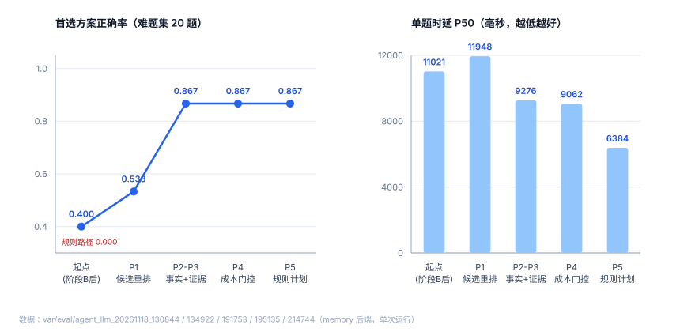

# P0–P5 增量总览：从「只会翻译口语」到「能推理、会追问、可审计、还便宜」

> 这份文档只做一件事：把 2026-11-18 这一天里六个阶段（P0–P5）的**改动、证据、边界**收拢到一处，
> 供论文/答辩直接引用。每个数字都能在 `var/eval/` 里找到对应的结果文件，每个改动都有提交号。
>
> 一句话结论：**接 LLM 之前，难题集首选方案 0/15、答案 0.65；现在是 13/15、答案 1.00，单题 6.4 秒、约 9.7k token，
> 且四项硬幻觉全程为 0。** 增量不是「模型更会说话」带来的，而是把 LLM 放进了三个具体决策点
> （口语→槽位与事实、候选内排序、证据够不够/该问什么），每次都用可复现的 A/B 验证。



## 1. 起点：六个结构性缺口

Review 时的判断：作为知识图谱/规则项目是合格的，作为 Agent 不合格——它是「单轮诊断管线 + 一个负责写文案的 LLM」。
根因不在模型，而在架构与度量：

| # | 缺口 | 证据 |
| --- | --- | --- |
| 1 | LLM 的结论被结构性丢弃 | `run_eval._run_agent` 的 fault/solution/claims 全取自 `run.diagnosis`（规则），LLM 只改 answer 文本 |
| 2 | 评测没在量 LLM | rule 与 agent 六项指标逐位相同；四项硬幻觉里 fabricated/dangling 对 agent_llm 恒 0（送检的是规则结构） |
| 3 | 对比基线是稻草人 | 旧 `rag` 不调 LLM、evidenceIds 写死 `["E1"]` |
| 4 | 工具拿不到可用的参数 | 证据摘要无 nodeId/docId；`get_document_span` 只回元数据 |
| 5 | 用户自述被丢掉 | `check_results` 只在 rule 分支传入；前端从不发；LLM 不抽取 |
| 6 | 没有澄清动作 | 无 `needs_info`，超出覆盖范围只回一句固定话术 |

## 2. 六个阶段

| 阶段 | 要解决的问题 | 做法 | 提交 | 关键证据 |
| --- | --- | --- | --- | --- |
| **P0** 让贡献可见 | 缺口 1–3 | LLM 答案 claims/warnings 回填并打到前端；`decision/expressed` 双评分；真 RAG 基线（BM25 + 一次 LLM） | `53ad936` `a4eacd7` `0d0cdca` `56f0175` | agent_llm 的 dangling/overclaim 从「空转」变成可判罚；真 RAG 在难题集 fabricate 39、overclaim 3 |
| **P1** 候选重排 | 规则候选里常有对的，但排不在第一 | 规则定候选，LLM 只在候选内排序（`RankOutput`），验证器只接受候选集内 id，安全方案锁首位 | `7f4555e` `8700693` | 难题集 topSolution 0.400 → 0.533（3 次重复一致），关重排消融 0.400；H07/H08 逐题翻转 |
| **P2** 听懂「我已经…」 | 用户说「清理过了/换过件」，系统仍推荐同一动作 | 图谱动作效应属性（`excludesCauses`/`exhaustsSelf`）+ R25/R26/R27 三处传导（故障→根因→方案）；事实抽取并入 decompose + 七道门；会话状态；按根因信息增益追问一个检查 | `5f1f19d` `ae1933f` `3a9658f` `da34979` `c6ee5e0` `f6d6bc7` | 8 道 precondition 首选方案 0/8 → 7/8；H14/H15 追问后首选检查收窄到 gold；50 题答案 0.98 → 1.00 |
| **P3** 证据可指认 | 「带引用」引用不到东西 | 摘要带 nodeId/docId/证据原文；`get_document_span` 回正文；新增 `search_documents`；运行时校验 claim 引用（全悬空整条丢弃） | `326c40f` `f7ab7ba` | 难题集 topSolution 0.533 → 0.867；文档工具 20/20 题命中；expressed 与 decision 首次对齐 |
| **P4** 成本工程 | 4–6 次往返、1.2 万 token | 分步毫秒计时；全覆盖不反思、无进展即停；80% 预算护栏；成本落盘；修正 decompose 漏记计数 | `88d68e9` `6bf4f06` `cdaa81b` | 调用 5.6 → 4.54，token 修正为 12.3k，50 题 P50 −10.2% |
| **P5** 延迟工程 | 9 秒/题 | 探索计划改由规则生成（相似案例 + 方案手册原文/症状检索 + 根因邻接）；**合并排序的实验因掉 3 题首选方案已回退** | `8b25830` `fc0023e` `85d7c9a` `3097f5c` | 难题集 P50 9062 → 6384（−29.6%），50 题 8967 → 5102（−43%），topSolution 不变 |

## 3. 数字总表

### 3.1 难题集（20 题，15 题有金标准；memory 后端）

| 系统 / 阶段 | 答案 | 首选故障 | **首选方案** | 文字首选 | 忠实度 | 硬幻觉四项 | P50 |
| --- | --- | --- | --- | --- | --- | --- | --- |
| 规则规则 `rule` | 0.650 | 0.611 | **0.000** | 0.000 | 0.513 | 0 | 7 ms |
| 确定性 Agent `agent` | 0.650 | 0.611 | **0.000** | 0.000 | 0.513 | 0 | 14 ms |
| LLM Agent 起点（P0 末） | 0.900 | 0.944 | 0.400 | 0.533 | 0.890 | 0 | 11021 ms |
| + P1 候选重排 | 0.900 | 0.944 | 0.533 | 0.467 | 0.890 | 0 | 11948 ms |
| + P2/P3 事实与证据 | 1.000 | 0.944 | **0.867** | 0.867 | 0.900 | 0 | 9276 ms |
| + P4 成本门控 | 1.000 | 0.944 | 0.867 | 0.800 | 0.880 | 0 | 9062 ms |
| + P5 规则计划 | 1.000 | 0.944 | **0.867** | 0.800 | 0.890 | 0 | **6384 ms** |

### 3.2 50 题（43 题有金标准）

| 系统 / 阶段 | 答案 | 首选故障 | **首选方案** | 文字首选 | 忠实度 | P50 |
| --- | --- | --- | --- | --- | --- | --- |
| 规则 `rule` | 0.980 | 1.000 | 0.791 | 0.791 | 0.804 | 7 ms |
| LLM Agent 起点（P0 末） | 0.980 | 1.000 | 0.791 | — ※ | 0.824 | 10545 ms |
| + P1 候选重排 | 0.980 | 1.000 | 0.884 | 0.744 | 0.848 | 11633 ms |
| + P2 多轮与追问 | 0.980 | 1.000 | 0.861 ※※ | 0.744 | 0.843 | 9795 ms |
| + P3 证据可指认 | 1.000 | 1.000 | 0.884 | 0.721 | 0.835 | 9990 ms |
| + P4 成本门控 | 1.000 | 1.000 | 0.884 | 0.721 | 0.848 | 8967 ms |
| + P5 规则计划 | 0.960 ※※※ | 1.000 | 0.884 | 0.674 | 0.848 | **5102 ms** |

> ※ 该次运行还没有 `expressed` 字段口径，记 —。
> ※※ P2 这轮 0.861 比 P1 少 1 题（Q014 换序），3 次重复后回到 0.884；单次 ±1 题不作为结论（P1 报告里的教训）。
> ※※※ 0.96 是两题**关键词**没命中（Q023 少「清理轮组」、Q034 少「升级过程网络中断」），答案内容与金标准语义一致；硬指标首选方案一位不差。
> 这条口径局限已经第三次出现，答辩时主动说明，比被追问更好。

### 3.3 成本

| 阶段 | 调用/题 | token/题 | P50（难题集 / 50 题） |
| --- | --- | --- | --- |
| P0 末 | — 未计量 | — | 11021 / 10545 ms |
| P2 末 | ≈5.6 | ≈14k（当时漏记 decompose，实际更高） | 9276 / 9795 ms |
| P4 | 4.60 / 4.54 | 12270 / 12318 | 9062 / 8967 ms |
| P5 | **3.05 / 2.70** | **9690 / 9253** | **6384 / 5102 ms** |

## 4. 三条可写进论文的论证

### 4.1 归因：哪些增量真的来自 LLM

| 增量 | 来自哪 | 是不是 LLM 的判断 |
| --- | --- | --- |
| 难题集 0.00 → 0.40 | 口语症状归一化（阶段 B）+ 槽位喂给规则 | **是**（把口语映射到图谱清单） |
| 0.40 → 0.533 | 候选内重排（P1） | **是**（排序，且消融可复现） |
| 0.533 → 0.867 | 自述事实排除根因（P2）+ 证据可指认（P3） | **一部分是**：事实由 LLM 抽取，但排除与传导是图谱属性 + 规则（R25–R27）；P3 让文字跟随结构 |
| 0.7907 → 0.8837（50 题） | 候选重排 | **是**（关重排回 0.7907 附近） |
| 9 s → 5–6.4 s | 规则计划（P5） | **否**（这是把 LLM 从它不擅长的决策点上拿下来） |

这句话可以当成答辩的主线：**LLM 的贡献集中在「理解人」与「在候选中做取舍」，不集中在「生成诊断」；
把它放到后者会既慢又不可控。**

### 4.2 评测口径本身是被修了三次的对象

1. **claims 回填**：之前 LLM 的结论根本没有进入指标（缺口 1）。
2. **双评分**：`answer_correct` 是关键词包含，提到即算对——用 `expressed`（答案里最先提到的方案）
   与 `decision`（结构化首选）并列，才发现「文字首选 0.533 > 结构首选 0.400」这类分叉。
3. **引用白名单**：P3 引入 chunkId 证据后，合法的 `DOC:…#p28r15` 一度被判成悬空（dangling 17 条假阳性），
   白名单扩成 `E* ∪ chunkId` 后才归零。**度量口径没跟上新证据类型，会凭空造出一次「退化」。**

同类教训还有：安全检测把「是否可继续使用**须以售后检测为准**」判成违规（已加 `_hedged`）；
题库路径写错会静默产出 n=0 的空结果（已改成立即失败）。

### 4.3 失败记录也是贡献

| 尝试 | 结果 | 学到的 |
| --- | --- | --- |
| 把候选排序并进 finalize（P5.1） | 50 题 topSolution 0.8837 → 0.7907/0.814，**已回退** | 省一次调用不等于省时间（输出 token 是主项）；把「最先该执行」改写成「最先推荐」会悄悄改变排序依据 |
| 旧 RAG 基线 | 0.25 答案、dangling 11、fabricated 39（真 RAG 版） | 稻草人对比没有意义；真 RAG 在这套多跳题上会编 |
| 按置信度路由到规则 | 未实施 | 难题集规则 topSolution=0，而 H01 置信度 0.82 却是错的——置信度不能当路由开关 |
| H05 雷达题 | 仍错 | 种子 cf（ESCALATE 0.70 > REPLACE-LDS 0.60）是**数据**问题，不是推理问题 |

## 5. 边界与局限（主动交代）

- **数据边界**：E11–E43 等错误码与部分边来自 `SYN:GENERATOR` 合成案例；`data/raw` 语料里搜不到这些码。论文必须声明。
- **闭世界**：只覆盖 T20 PRO；T30 PRO / X5 PRO 走 `unknown_model` 降级。
- **安全为 0 是规则锁的结果**，不是 LLM 学会了安全——`_apply_ranking` 会把非安全方案从首位挪走。
- **coverage 长期 0.68–0.73**：缺 q4（耗材兼容）/q5（保修转售后）的图谱覆盖，是数据缺口。
- **追问只问一次**（`allow_ask=not asked_checks`），且 H16 因图谱只有一条根因而无法追问。
- **单机、串行、单次运行**：P50 受 DeepSeek 抖动 ±2 s；`answer/expressed` 是关键词口径，会随措辞波动。
- **演示脚本未做**（用户要求用 git 回退自行查看）。

## 6. 索引

- 阶段报告：`reports/p0-attribution.md`、`p1-rerank.md`、`p2-multiturn.md`、`p3-exploration.md`、`p4-cost.md`、`p5-latency.md`
- 可行性分析与路线计划：本地维护，未随仓库发布（结论已并入本文 §3–§4 与各阶段报告）
- 总报告：`reports/final-report.md`（§8.5 已标注「逐位相同」为历史口径）
- 结果文件：`var/eval/agent_llm_20261118_*.json`（每次运行的逐题行 + 汇总）
- 测试：`200 passed, 2 skipped`（当次收集 202 项）；回退点 `pre-p0`；分支 `p0/llm-attribution`

```powershell
$env:KG_BACKEND='memory'
.\.venv\Scripts\python.exe -m backend.app.eval.run_eval --system agent_llm --questions data/eval/questions_hard.jsonl --repeat 1
.\.venv\Scripts\python.exe -m backend.app.eval.run_eval --system agent_llm --questions data/eval/questions.jsonl --repeat 1
.\.venv\Scripts\python.exe scripts\make_fig3.py   # 重新生成总览图
```
